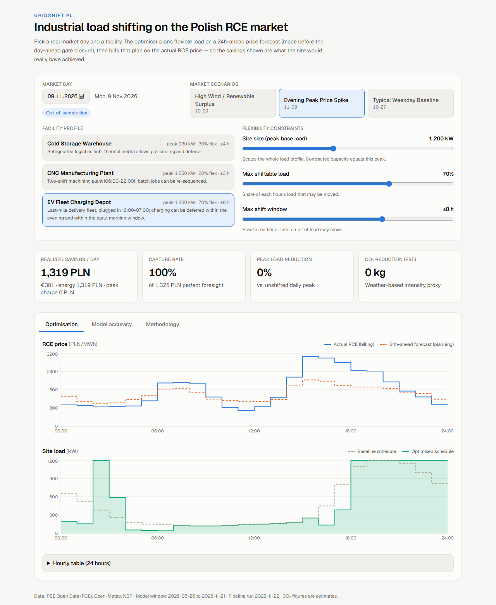
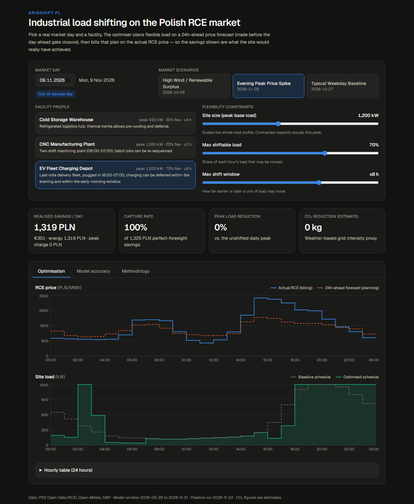
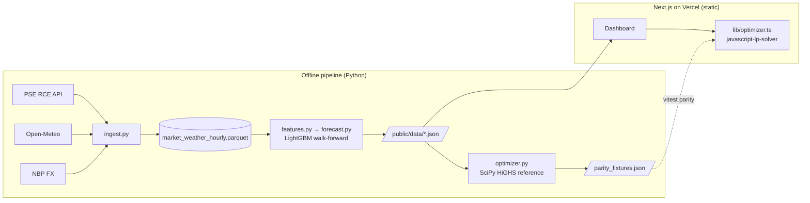

# GridShift PL

**Industrial load shifting and energy-cost optimisation on the Polish wholesale electricity market (RCE).**

GridShift PL is an interactive simulator built on real Polish market data. It plans a factory's flexible load on a 24-hour-ahead price forecast, then bills that plan on the **actual** RCE price. The savings it reports are therefore what the site would really have achieved, not what perfect hindsight would allow.



| | |
|---|---|
| **Stack** | Python (pandas, LightGBM, SciPy HiGHS) · Next.js 15 (App Router, TypeScript, Tailwind CSS, Recharts) |
| **Data** | 18,244 quarter-hourly RCE prices, aggregated to 4,561 hourly rows across 190 days, plus weather for 4 cities and daily EUR/PLN. All sources are keyless public APIs. |
| **Model** | 24h-ahead LightGBM: **MAE 212 PLN/MWh, 21.2% better than naive persistence** on a 60-day out-of-sample walk-forward test |
| **Optimiser** | Linear programme in Python (reference) and TypeScript (in-browser), parity-tested on 18 fixture cases. A solve takes about 3 ms in the browser. |
| **Deploy** | Static Next.js build with no Python runtime and no secrets. Ready for Vercel. |

---

## 1. The business problem

Since mid-2024, Polish businesses have faced an RCE price (*Rynkowa Cena Energii Elektrycznej*) that moves every 15 minutes. It is derived from the day-ahead market and can swing from **negative values to above 3,600 PLN/MWh** within the same season. A site with flexible load (cold storage, batch manufacturing, an EV fleet) can move consumption away from expensive hours. It can only do that, though, if it knows the prices before committing its schedule.

**The question GridShift answers:** *If the site had planned tomorrow's load on our forecast, before the day-ahead gate closure, how much would it actually have saved, and how close is that to the theoretical maximum?*

## 2. Data pipeline (`pipeline/ingest.py`)

| Source | Endpoint | Content |
|---|---|---|
| PSE Open Data v2 | `api.raporty.pse.pl/api/rce-pln` | Quarter-hourly RCE (PLN/MWh). OData `$filter` on `business_date`, `nextLink` pagination (100 rows per page) |
| Open-Meteo | archive + forecast API | Hourly `temperature_2m`, `wind_speed_100m`, `shortwave_radiation` for Warsaw, Gdańsk, Katowice and Poznań |
| NBP | `api.nbp.pl` table A | Daily EUR/PLN mid rate, forward-filled over weekends and holidays |

- Timestamps travel in UTC (`dtime_utc`, `timezone=GMT`) and are converted to `Europe/Warsaw` locally. This makes DST days unambiguous. The autumn change on 2026-10-25 keeps its true **25 hours**.
- The pipeline enforces strict validation: every hour must have exactly 4 quarter-hours, there must be no duplicate timestamps, and gaps are forward-filled for at most 2 hours. Any remaining NaN fails the run.
- Output is `data/processed/market_weather_hourly.parquet` (git-ignored): **4,561 rows covering 2026-05-16 to 2026-11-21, with 0 nulls and 0 duplicates**. Prices have a mean of 626 PLN/MWh, a median of 590, a minimum of −325 and a maximum of 3,661.

## 3. Forecasting without leakage (`pipeline/features.py`, `pipeline/forecast.py`)

**Decision time.** The forecast for delivery day D is made on **D−1 at about 10:00, before the day-ahead auction gate closes** and before D prices are published. At that moment, prices up to the end of D−1 are public. This is why the site needs a forecast at all.

**Features** (18 in total):
- Cyclical hour and weekday encodings, the month, a weekend flag, and Polish public holidays (`holidays`).
- Prices at the same clock hour on D−1, D−2 and D−7. These lags are **joined on calendar days, not row offsets**, so they stay correct on 23-hour and 25-hour days.
- The previous day's mean, standard deviation and maximum, plus a 7-day pooled mean and volatility. All of them come from days strictly before D.
- Regional wind index (mean of wind speed cubed, a proxy for wind power), solar index and mean temperature.

**Leakage test:** `tests/test_features.py` overwrites every price of one day with 1,000,000 and asserts that none of that day's feature rows change.

**Evaluation.** Training covers 2026-05-26 to 2026-09-22 (120 days). The test period runs from 2026-09-23 to 2026-11-21 (60 days, 1,441 hours) and is predicted out-of-sample, with an **expanding-window refit every 7 days**.

| Model (test period) | MAE (PLN/MWh) | RMSE (PLN/MWh) |
|---|---:|---:|
| **LightGBM 24h-ahead** | **212.3** | **342.4** |
| Naive persistence (same hour, D−1) | 269.4 | 411.4 |
| Improvement | **−21.2%** | **−16.8%** |

The most important features, ranked by gain, are the D−1 price at the same hour, the D−7 price at the same hour, the solar index, the wind index and the D−2 price. In other words, the model learns that renewable output is what breaks the "tomorrow looks like today" pattern.

## 4. Optimisation (`pipeline/optimizer.py`, `lib/optimizer.ts`)

For one local day with hours *t*, the decision variable `x[s,t] ≥ 0` is the kW moved from hour *s* to hour *t*, where `0 < |s−t| ≤ W`:

```
minimise    Σ_t p̂_t · L_t / 1000  +  λ · P          (energy cost + peak demand charge)
subject to  Σ_t x[s,t] ≤ f · b_s                     (max shiftable share per hour)
            x[s,t] = 0 unless s, t are available     (e.g. EV plugged in 16:00–07:00)
            L_t ≤ C                                  (contracted capacity = current peak)
            L_t ≤ P                                  (daily peak)
where       L_t = b_t − Σ_t' x[t,t'] + Σ_s x[s,t]    (energy conserved by construction)
```

- **Plan on the forecast, bill on actuals.** The schedule is optimised on the forecast price p̂ and costed on the actual price p. Solving the same LP on p gives the **perfect-foresight** bound. The **capture rate** is realised savings divided by that bound, which turns forecast quality into money.
- **Two solvers, one formulation.** SciPy HiGHS is the reference. `javascript-lp-solver` re-solves in the browser whenever a slider moves. A vitest suite checks every KPI against Python on 18 fixtures: 3 profiles × 3 scenario days × 2 slider settings.

**Results on the three scenario days** (out-of-sample days, default profile settings, PLN per day):

| Profile | Scenario day | Realised savings | Perfect foresight | Capture rate |
|---|---|---:|---:|---:|
| Cold Storage Warehouse (930 kW, 30%, ±4 h) | High wind, 2026-10-09 | 381 | 381 | 100% |
| | Evening spike, 2026-11-09 | 2,436 | 2,436 | 100% |
| | Typical weekday, 2026-10-27 | 886 | 1,038 | 85% |
| CNC Manufacturing Plant (1,550 kW, 20%, ±3 h) | High wind | 514 | 526 | 98% |
| | Evening spike | 3,118 | 3,123 | 100% |
| | Typical weekday | 1,175 | 1,370 | 86% |
| EV Fleet Charging Depot (1,200 kW, 70%, ±8 h, plugged in 16:00–07:00) | High wind | 461 | 487 | 95% |
| | Evening spike | 1,319 | 1,325 | 100% |
| | Typical weekday | 519 | 663 | 78% |

Even though hourly price errors average 212 PLN/MWh, the plan captures **78–100%** of the theoretical value. Load shifting depends on getting the *ordering* of hours right inside the shift window, not on hitting each price exactly.

## 5. The dashboard (`app/`, `components/`)



- **Market day picker** covers all 180 modelled days. A badge marks each day as out-of-sample or in-sample (training period).
- **One-click scenarios:** *High Wind / Renewable Surplus*, *Evening Peak Price Spike* and *Typical Weekday Baseline*. The pipeline selects these days automatically by rule.
- **Facility profiles and sliders** control site size, maximum shiftable share and shift window. The LP re-solves instantly.
- **KPI cards** show realised savings (PLN and EUR, split into energy and peak charge), capture rate, peak load reduction, and CO₂ reduction (labelled as an estimate). Loss days are shown in red rather than hidden.
- **Tabs:** synced price and load charts with an hourly table, model accuracy (metrics, forecast vs. actual vs. persistence, feature importance), and methodology.
- Light and dark themes, responsive down to 375 px. Data is read at build time, so the page is fully static.

## 6. Architecture



## 7. Assumptions and limitations

- **Weather for day D uses observed values** as a stand-in for a day-ahead weather forecast, because historical forecasts are not available keylessly. Real-world accuracy would be somewhat lower.
- **The CO₂ figures are an estimate.** Hourly intensity starts from the KOBiZE end-user grid factor (597 kg CO₂/MWh, December 2024 edition). It is lowered by up to 35% when regional wind and solar output are high, and rescaled so its mean equals the official factor.
- **The peak demand charge is an assumption:** 0.60 PLN per kW of daily peak, roughly 18 PLN/kW per month. Energy arbitrage usually dominates, so peak reduction is often 0%. This result is reported honestly.
- **Not modelled:** cross-midnight shifting, network tariffs beyond the peak charge, intraday or balancing markets, and process rebound effects.
- The 180-day window runs from May to November, so it contains the autumn DST change but not the spring one. Spring handling is covered by unit tests only.

## 8. Run it locally

Requires Python 3.11+ and Node.js 20+.

```bash
# Python pipeline
python -m venv .venv && .venv/Scripts/activate     # source .venv/bin/activate on macOS/Linux
pip install -r requirements.txt
python -m pipeline.ingest      # ~1 min: fetch RCE, weather, FX -> data/processed/*.parquet
python -m pipeline.forecast    # train, evaluate, export public/data/*.json
python -m pipeline.optimizer   # reference LP + TypeScript parity fixtures
pytest -q                      # 26 tests

# Web app
npm install
npm test                       # 27 vitest tests (incl. Python parity)
npm run dev                    # http://localhost:3000
npm run build                  # static production build
```

Re-running the pipeline moves the 180-day window forward to yesterday. Commit the refreshed `public/data/` to update the deployed site.

## 9. Project structure

```
pipeline/   config · ingest · features · forecast · co2 · profiles · optimizer
tests/      pytest: DST parsing, pagination, leakage, walk-forward, LP invariants
app/        Next.js App Router entry (static)
components/ dashboard UI (controls, KPI cards, charts, tabs)
lib/        optimizer.ts · profiles.ts · types · formatting · vitest suites
public/data days.json · metrics.json · feature_importance.json · scenarios.json
docs/       design spec, implementation plan, screenshots
```
